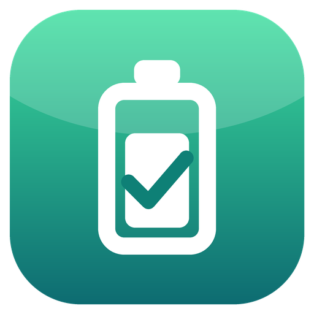
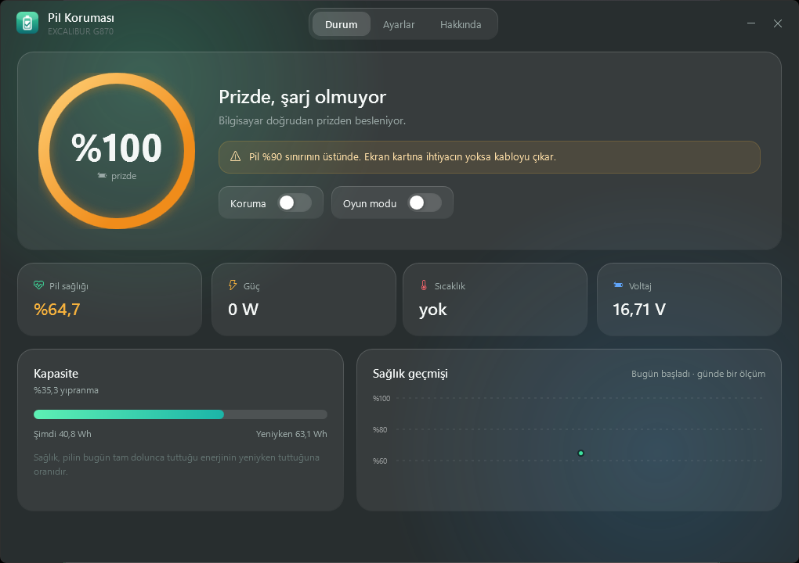
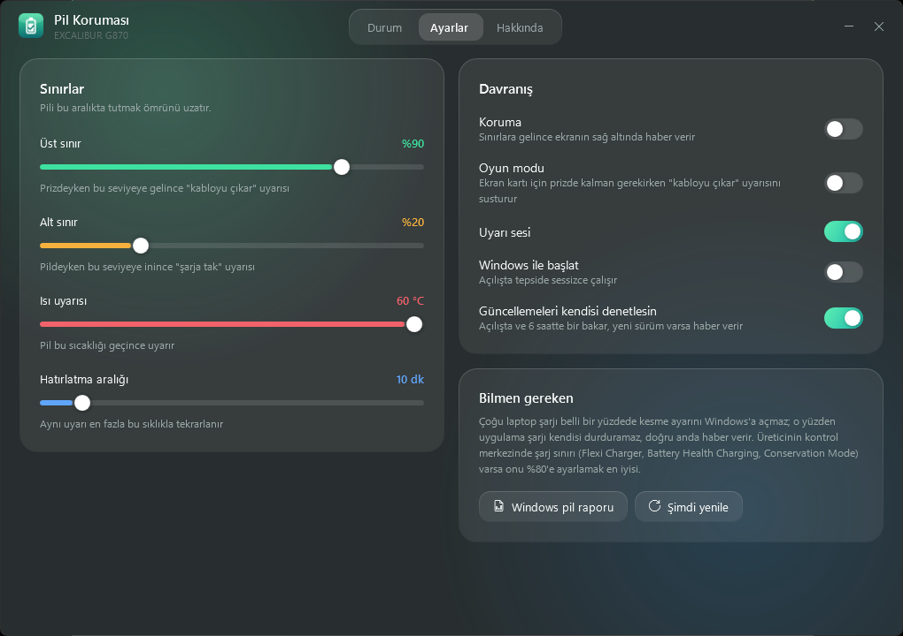
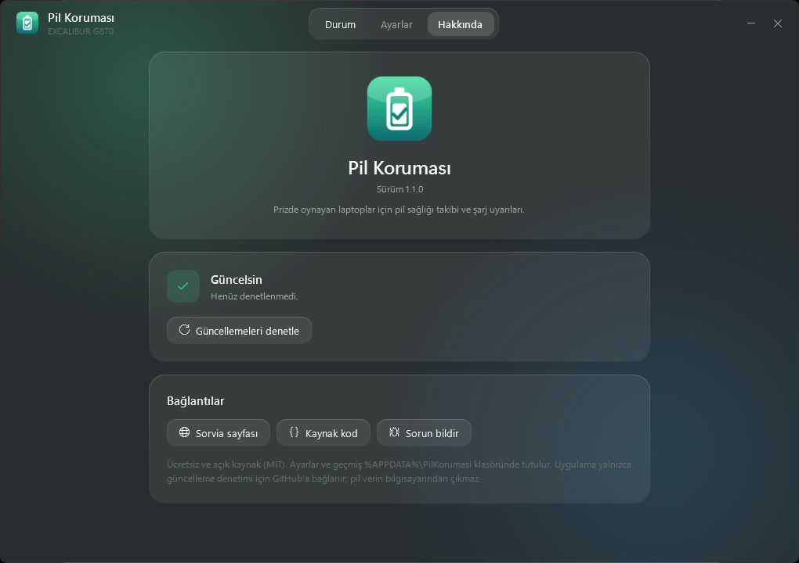

<p align="center"></p>

# Pil Koruması

Windows laptoplar için pil sağlığı takibi ve şarj uyarıları. Özellikle prize takılı kullanmak zorunda olan oyun laptopları için.



## Ne yapar

- **Anlık durum:** şarj yüzdesi, şarj ya da harcama gücü (W), kalan süre, voltaj, varsa pil sıcaklığı.
- **Pil sağlığı:** pilin yeniyken tuttuğu enerji ile bugün tuttuğu enerjinin oranı, yıpranma yüzdesi, döngü sayısı.
- **Sağlık geçmişi:** her gün bir ölçüm kaydeder ve grafikte gösterir. Pilin ne hızla yıprandığını görürsün.
- **Koruma uyarıları** (ekranın sağ altında):
  - Prizdeyken üst sınıra (varsayılan %80) gelince "kabloyu çıkarabilirsin".
  - Pildeyken alt sınıra (varsayılan %30) inince "şarja tak".
  - Pil sıcaklığı sınırı geçince "pil çok ısındı".
- **Oyun modu:** ekran kartı için prizde kalman gerektiğinde "kabloyu çıkar" uyarısını susturur.
- **Sistem tepsisi:** simgede yüzde ve renkli halka görünür. Sağ tık menüsünden koruma ve oyun modu açılıp kapanır.
- **Windows ile başlat:** isteğe bağlı, tepside sessizce açılır.
- **Cam arayüz:** Windows 11'de akrilik pencere, akıcı geçişler ve canlı göstergeler. Durum, Ayarlar ve Hakkında sekmeleri.
- **Kendini günceller:** açılışta ve 6 saatte bir yeni sürüme bakar, tek tıkla indirip kurar ve yeniden başlar.
- **Windows pil raporu:** tek tıkla masaüstüne `pil-raporu.html` oluşturur ve açar.

| Ayarlar | Hakkında |
|---|---|
|  |  |

## Kurulum

[Releases](../../releases) sayfasından `PilKorumasi.exe` dosyasını indir ve çalıştır. Kurulum gerekmez, .NET kurmana da gerek yok. Sorvia'dan da ücretsiz indirebilirsin: https://sorvia.net/urunler/pil-korumasi

1.0.0 kullanıyorsan 1.1.0'ı bir kez elle indir; sonraki sürümler uygulamanın içinden gelir.

Ayarlar ve geçmiş `%APPDATA%\PilKorumasi` klasöründe tutulur.

## Bilmen gereken

Uygulama şarjı kendisi durduramaz. Şarjı belirli bir yüzdede kesmek donanımın işidir ve çoğu laptop bunu Windows'a açmaz. Pil Koruması doğru anda haber verir; kabloyu sen çıkarırsın.

Laptopunun üreticisinin kontrol merkezinde şarj sınırı ayarı varsa (Lenovo Vantage "Conservation Mode", ASUS "Battery Health Charging", Casper/Clevo "Flexi Charger" gibi) onu %80'e ayarlamak en iyisidir. Bu uygulama da onunla birlikte sağlığı izlemeye devam eder.

## Sürüm yayınlama

`src/PilKorumasi.csproj` içindeki `Version`'ı yükselt, exe'yi derle ve `vX.Y.Z` etiketli bir GitHub release'e `PilKorumasi.exe` adıyla yükle. Uygulamalar güncellemeyi oradan alır; release açıklaması uygulamada "Yenilikler" olarak görünür.

## Derleme

.NET 10 SDK gerekir.

```
dotnet publish src/PilKorumasi.csproj -c Release -r win-x64 --self-contained true -p:PublishSingleFile=true -p:EnableCompressionInSingleFile=true -p:IncludeNativeLibrariesForSelfExtract=true -p:DebugType=none -o publish
```

## Lisans

MIT
